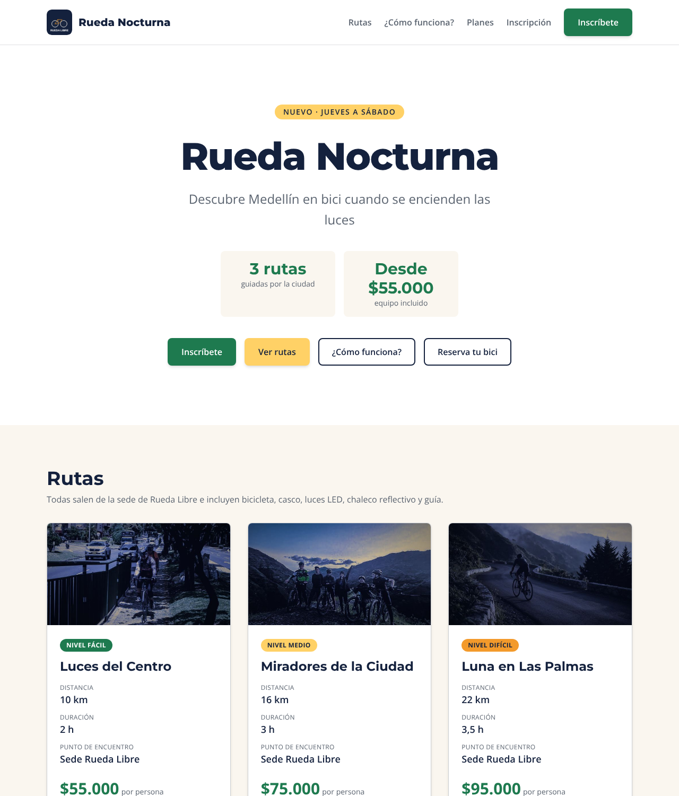
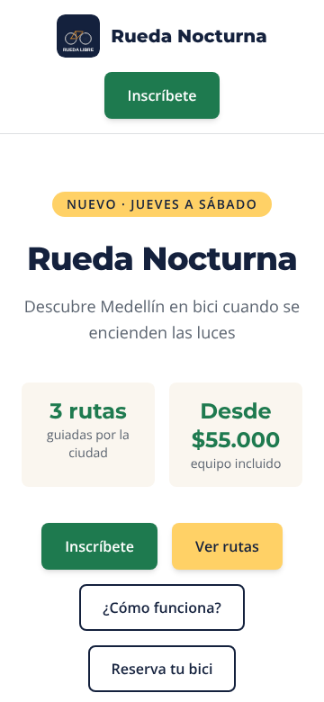
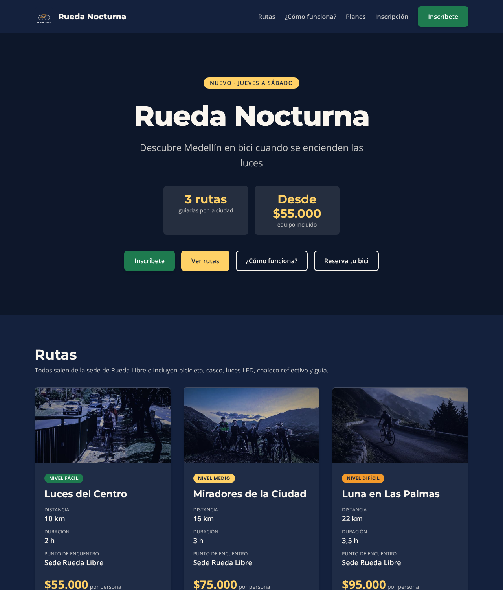
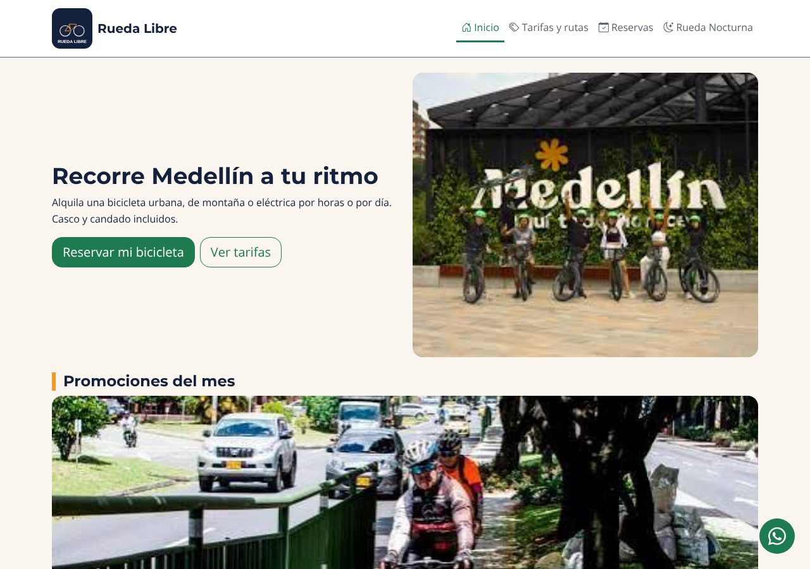

# Rueda Nocturna · Week 3 · Day 3 · Launch

Rueda Libre is a local bike rental business in Medellín. This week the client launched **Rueda Nocturna**: guided night bike rides through the city, Thursday to Saturday at 7:30 p. m. I built its landing with **Tailwind CSS** and connected it with the main site **Rueda Libre v2.0**, made with **Bootstrap 5.3**. Together they are the Rueda Libre web ecosystem I built during the module.


## Pages
| Page | Framework | What it has |
|---|---|---|
| `index.html` | Bootstrap | Hero, promotions carousel (4th slide: Rueda Nocturna), services, benefits, fleet, routes, how to rent and contact |
| `paginas/tarifas.html` | Bootstrap | Rental and guided tour price tables |
| `paginas/reservas.html` | Bootstrap | Reservation form with native validation, a dismissible alert and the rental policies modal |
| `nocturna/index.html` | Tailwind | Landing: hero, routes, how it works, plans, registration form |
| `nocturna/componentes.html` | Tailwind | Component kit: buttons, card, alerts and fields |
| `nocturna/prototipo.html` | Tailwind (Play CDN) | First prototype of the hero |

The navbar of the site has a "Rueda Nocturna" link on every page, and the landing goes back to the site (logo) and to reservations ("Reserva tu bici").

## Structure
```
Dia3/
├── README.md
├── bitacora.md
├── capturas/            screenshots for this README
├── index.html           site v2.0 (Bootstrap)
├── paginas/             tarifas.html, reservas.html
├── css/styles.css       brand identity over Bootstrap
├── img/                 images of the site
└── nocturna/            landing (Tailwind)
    ├── index.html, componentes.html, prototipo.html
    ├── src/input.css    (@import, @theme, 3 classes with @apply)
    ├── src/output.css   (generated and minified by the CLI)
    ├── img/
    └── .gitignore       (node_modules/)
```

## Technologies
- Semantic HTML5 and native form validation (`required`, `minlength`, `pattern`, `min`, `max`)
- **Bootstrap 5.3.3** (CDN): grid, utilities, navbar, cards, carousel, alert, modal, `--bs-*` variables and Bootstrap Icons
- **Tailwind CSS 4** with the CLI: utilities, mobile-first (`sm:`, `md:`, `lg:`), `@theme`, dark mode with `dark:`, `@layer components` + `@apply`
- Google Fonts (Montserrat and Open Sans), GitHub Pages

## How to run the landing locally
```bash
cd nocturna
npm install tailwindcss @tailwindcss/cli
npx @tailwindcss/cli -i ./src/input.css -o ./src/output.css --watch    # regenerates src/output.css
npx @tailwindcss/cli -i ./src/input.css -o ./src/output.css --minify   # minified version for publishing
```
Then open `index.html` with Live Server. The site pages do not need any build step.

## Screenshots
| Desktop | Mobile | Dark mode |
|---|---|---|
|  |  |  |



## Framework recommendation
I built the same brand with both frameworks, so I compared them with my own data (MiniChallenge 8):

| Criterion | Bootstrap | Tailwind |
|---|---|---|
| Learning curve | Faster to start: grid and components copied from the docs | Slower at first (many utilities, Node and the CLI), very fast once the kit exists |
| Customization | Overriding `--bs-*` in `styles.css`, and some states (form focus, carousel controls) have no variables | `@theme` creates the brand utilities and `dark:` gives the dark mode |
| Final size | 306.1 KB of CSS + JS (+ 211 KB of icons) | 26.6 KB of CSS for the whole landing, 0 KB of JS |
| Use cases | Admin panels, prototypes, interactive components without writing JS | Sites with their own identity and mobile traffic |

**Recommendation:** Tailwind CSS for the next version of the whole site. It is a small content site with a strong brand and mostly mobile visitors. The cost is writing a little JavaScript (or simplifying) for the navbar, the carousel and the modal that today come from the Bootstrap bundle.

## Final checklist
- [x] Semantic structure: one `h1` per page and ordered headings
- [x] Accessibility: `alt` on every image, contrast ≥ 4.5:1 (light and dark), visible focus and keyboard navigation
- [x] Forms validated with native validation (reservations and registration)
- [x] Responsive at 360, 768 and 1280 px, no horizontal scroll
- [x] Light and dark mode in the landing
- [x] 0 errors 404, no inline styles
- [x] `output.css` minified and committed
- [x] W3C validator: 0 errors and 0 warnings in the landing, the kit, the prototype and the three site pages

## What I learned
- A component framework gives finished pieces that I adapt; a utility-first framework gives building blocks and the design is mine.
- Tailwind only generates the classes it finds written complete in my files; that is why the CSS is so small.
- Mobile-first is easier to read: the class without a prefix is the phone, and the prefixes only add what changes.
- `@apply` is useful for one small piece that repeats a lot (buttons), not to rebuild a whole framework.
- The box model still matters inside a framework: a thicker border moved a button 2 px; a `ring` solved it because it does not take space.
- The same brand can live in two frameworks if the color values are the same in both.

## Versions
| Version | What it has |
|---|---|
| v1.5 | Flexbox, Grid and mobile-first with my own CSS |
| v2.0 | The site migrated to Bootstrap with the brand identity |
| v3.0 | Rueda Nocturna in Tailwind, integrated with the site |

## Author
Coder of Riwi · Ruta Desarrollo de Software · [mariangeles05](https://github.com/mariangeles05)
